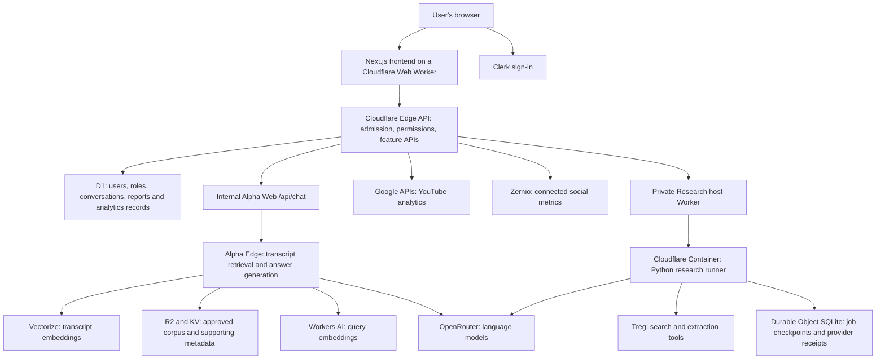

# WTF OS — architecture and user-flow snapshot (21 October 2026)

Reviewed: 21 October 2026. Source baseline: `a389a11` on `feature/pavun`.

> Historical snapshot, retained for reference. Later Claude migration, research
> UI changes, citation fixes and PR #86 are not reflected below. For the latest
> implementation and deployment receipts, see [.project/HANDOFF.md](.project/HANDOFF.md)
> and [the generated service map](docs/architecture/SERVICES.md).

This describes implemented code and recorded deployments, rather than the full
Phase 1/Phase 2 wish list. Cloudflare deployment metadata was read during this
review. It does not replace signed-in acceptance testing of every feature.

## 1. What the product is

WTF OS brings four main tools into one authenticated workspace:

| Tool | User need | Evidence used |
| --- | --- | --- |
| Ask WTF | Ask questions about the podcast catalogue and find relevant moments | Approved published/uncut transcript evidence |
| YouTube Analytics | Understand channel/video performance and compare results | Google APIs and synchronized analytics observations |
| Social Analytics | Understand connected social accounts and compare metrics | Zernio account, dashboard and post data |
| Research | Prepare a guest/company/industry brief before a shoot | Public web/social evidence retrieved through Treg |

The surrounding product provides account admission, roles, navigation, episode
browsing, topic connections, saved conversations/reports, settings and admin
controls. These four tools share the application shell but do not share one
unrestricted AI agent or one evidence database.

## 2. What is deployed where

| Environment | Public address | Current position |
| --- | --- | --- |
| Production | https://wtfhq.in | Authenticated app and existing Ask WTF experience. YouTube Analytics is deliberately hidden and its page redirects to chat. Research and Social Analytics have not been promoted by the recorded releases. |
| Staging | https://beta-staging.wtfhq.in | Newer application with YouTube Analytics, Social Analytics and Research. Latest frontend includes grouped research sources and the single-tilde formatting correction. |
| Local development | http://localhost:3000 | Next frontend plus local Edge and, for local research execution, the Python service. Configuration can point at shared staging data; local does not automatically mean an isolated database. |

Verified Worker versions, all at 100% traffic at review time:

| Runtime | Version |
| --- | --- |
| Staging Web | `ea504264-795e-4532-96d1-b7789dcc463e` |
| Staging Edge | `1686db84-f7e8-4c39-b760-d00e61dc44fd` |
| Staging Research host | `21cbc9e3-6757-4f69-b1ae-470f4d864b86` |
| Production authenticated Web | `e0a702a0-a19b-4445-9473-335c8fa539af` |
| Production Edge / Alpha inference backend | `bad9782e-6844-400a-bdfb-1992ffadface` |
| Internal Alpha Web | `3d5a5965-14f3-486a-a608-330d539dec81` |

The latest staging frontend was built from `785f133`. The later commit adds its
deployment receipt. The runner and Edge have separate release histories; one
frontend deployment does not deploy all services.

## 3. System architecture



In production, the Edge performing authenticated application work and the Edge
providing Alpha inference currently share the `wtfmedia-edge` Worker identity.
The diagram separates responsibilities, not necessarily separate deployments.
Staging has its own Edge and D1, but calls the existing Alpha answer service.

### Frontend

- Next.js 15, React 19 and TypeScript.
- Tailwind styling and shared UI components.
- OpenNext packages Next.js for Cloudflare Workers.
- The Web Worker serves pages, static assets and same-origin API proxies.
- Shared AppShell/AppRail and principal-aware navigation keep the experience
  consistent across user roles.
- Research prose uses React Markdown/GFM with safe links and source components.

### Edge API

The TypeScript Edge Worker validates identity, loads the authoritative D1 role,
checks capabilities and ownership, handles feature requests, and persists data.
The browser does not receive provider credentials or direct database access.

### Research runtime

Research needs longer-lived Python execution, so it runs in a Cloudflare
Container behind a private Worker. The host verifies a server-to-server bearer
token. A separate state token protects its Durable Object storage API.

The current host declares one container instance. A supervised Python research
worker processes jobs; this is not a horizontally scaled pool of independent
research agents. A minute cron checks for active work and wakes/keeps the
container available. It does not start a new research report every minute.

## 4. Login, admission and roles

1. The user opens the app and signs in with Clerk.
2. The application obtains a Clerk identity/session.
3. The Edge verifies that identity against the environment's issuer and
   authorized origin.
4. D1 determines whether the user is admitted, active and allowed to act.
5. The app receives a verified principal containing its role/capabilities.
6. `/beta` routes members to `/beta/chat` and operators to `/beta/workspace`.
7. Navigation reflects those capabilities; the server checks permissions again
   for protected requests.

Successful Clerk login alone does not grant application access. Suspended,
revoked or inactive records can deny admission. An operator record takes
precedence over a member record for the same identity.

| Action | Member | Editor | Admin | Super-admin |
| --- | --- | --- | --- | --- |
| Use Ask WTF and own chat history | Yes | Yes | Yes | Yes |
| Create/use research | Yes | Yes | Yes | Yes |
| View enabled analytics and ask metric questions | Yes | Yes | Yes | Yes |
| Connect/select analytics accounts | No | No | Yes | Yes |
| Open operator control room | No | Yes | Yes | Yes |
| Manage users / view administrative audit | No | No | Yes | Yes |
| Release management | No | No | No | Yes |

Feature enablement and environment restrictions apply in addition to this table.
Permissions are enforced by the Edge, not by the presence of a button.

Staging and production use different Clerk environments and D1 role records.
Being an admin in staging does not establish that role in production.

## 5. Ask WTF: user journey and answer pipeline

### User journey

1. Open **Ask WTF**.
2. Start or reopen a conversation.
3. Choose published, uncut or both source modes, and an episode scope where
   appropriate.
4. Ask a question.
5. Read the answer with citations and inspect supporting sources/moments.
6. Ask follow-up questions using the bounded conversation context.
7. Return to saved history; archive or permanently delete through the relevant
   confirmed lifecycle controls.

### Request journey

```text
Question + conversation context
  → authenticated Beta API
  → owner-scoped conversation/message storage
  → Alpha's existing /api/chat contract
  → query interpretation / follow-up reformulation
  → Workers AI query embedding
  → Vectorize transcript retrieval
  → source-mode, episode and provenance checks
  → OpenRouter answer generation
  → citation/grounding validation and repair/fallback
  → source/moment projection
  → validated result saved to the user's conversation
  → browser display
```

The Alpha gateway sends bounded chat turns and supported scope information.
It does not send Clerk credentials, D1 owner identifiers or saved private
preferences to Alpha. Beta stores the validated public answer/source projection;
it does not maintain a second transcript index.

The answer is not guaranteed merely because a model returns text. The code
checks evidence and citations, can attempt repair, and can return limited
evidence or an abstention when a grounded answer is unavailable.

Moment links depend on available timestamps and mapping. A known association
between an uncut file and a published episode is not proof of synchronized
timestamps across the two timelines.

## 6. Transcript ingestion and catalogue

This is a separate corpus-management pipeline:

```text
Approved source asset and R2 object
  → ingestion admission
  → Cloudflare Queue
  → transcript processing / provenance records
  → chunks and embeddings
  → Vectorize index and supporting metadata
  → available to Alpha retrieval
```

- D1 tracks source assets, transcript versions, chunks and ingestion jobs.
- R2 stores corpus objects; KV holds supporting retrieval/state metadata.
- Failed queue jobs retry within configured limits and can reach a dead-letter
  queue.
- Missing approved source receipts fail closed instead of inventing evidence.
- Beta does not expose a separate ingest pipeline.

The repository's last approved corpus receipt records 55 published assets,
49 mapped uncut assets and 11,948 indexed vectors. These are historical
receipts, not a fresh corpus recount in this review.

Episode browsing exposes catalogue information and approved source mappings.
Connections shows a generated topic graph through `/api/connections`, letting
users explore relationships and occurrences across episodes. It is not a new
live web search on each click.

## 7. YouTube Analytics: complete flow

### Admin setup

1. Admin opens the enabled YouTube Analytics workspace.
2. Chooses **Connect Google** and completes Google consent.
3. OAuth state/callback checks associate the connection with the environment.
4. The backend stores encrypted credentials.
5. Admin selects the authorized channel and triggers synchronization.
6. The backend obtains channel/video metadata and supported analytics reports.
7. The dashboard becomes available to users with `analytics:read`.

Connections are shared workspace resources. Regular users and editors can read
and ask questions; they cannot change the connection.

### Dashboard and chat

Users choose date ranges, content/video scope and episode comparison windows.
The workspace displays channel trends and compares videos, including matched
post-publication windows where supported.

The assistant follows this path:

```text
Question + selected dates/videos + recent conversation
  → model creates a query plan
  → server validates allowed intent, metric, entity and dates
  → channel-scoped video resolution
  → Google API or synchronized comparison evidence
  → calculations in application code
  → structured answer with dates, identity, sources and limitations
```

Implemented intents include single-video/channel metrics, supported rankings,
date-period comparisons and two-video comparisons. Follow-ups such as “the
second video's performance” should resolve one prior video rather than repeat
the entire comparison. Ambiguous titles can require a user choice.

Supported metric families include views, watch time, viewing duration,
percentage viewed, subscribers gained/lost, likes, comments and shares.
Impressions/CTR can appear in comparison/dashboard evidence when available;
this does not mean every arbitrary chat request can retrieve those metrics.

Important interpretation rules:

- Selected-period views and lifetime public video views are different values.
- Publication windows and calendar-date windows are different comparisons.
- Missing data must remain unavailable; a reported zero is different.
- Google reporting may lag.
- A measured change does not prove what caused it.

Users can save, reopen and delete their own analytics investigations. Saved
answers are snapshots, not a guarantee that every number is current.

YouTube Analytics is currently hidden in production by the owner's instruction.
That frontend change did not erase the connection or historical analytics data.

## 8. Social Analytics: complete flow

### Account setup

Zernio is the integration provider for LinkedIn, Instagram, Facebook and X
metrics in this feature.

1. The backend uses its Zernio API key to discover accessible profiles.
2. A sole profile or unique default can be selected automatically.
3. When the result is ambiguous, an admin selects the workspace/profile.
4. Admin connects/reconnects social accounts through the provider handoff.
5. Other admitted users can read metrics and use the assistant.

There is no requirement for users to type a profile ID when automatic discovery
can resolve it. An explicit selection is respected; a stale selection must not
silently switch to a different workspace.

### Dashboard and assistant

Users choose platforms/dates, inspect metric cards, trends and posts, then ask
questions about the selected data.

The assistant validates a model-produced query plan, fetches bounded
profile/account-scoped Zernio evidence, and calculates answers in code.
Model-generated numeric values are not the evidence.

Supported requests include platform summaries, platform/period comparisons,
post comparisons, supported metric rankings and daily trends. Follow-up
references resolve previous entities; explicit new filters take precedence.

Limits are disclosed: provider pagination is bounded, some metrics differ in
definition across networks, post lifetime totals are not period activity, and
first-N-day post comparisons need historical observations. A partial scan is
not presented as a definitive all-time winner.

Chat controls include suggestions, retry, stop waiting, copy/download and
private save/reopen/delete. Stopping the browser wait does not guarantee
provider work or billing has stopped.

The social connections are shared, but saved social conversations are
account-scoped. Removing a normal user's saved history does not disconnect
the shared workspace accounts.

## 9. Research: complete user and processing flow

### Inputs

The user supplies:

- Guest name.
- Company name.
- Industry.
- Optional private editorial notes and approval to use them.

Example scope: Elon Musk, Tesla, electric vehicles. India is the audience
context throughout the report, while the research can use global sources.
It is not a restriction that every source must be Indian or a separate
India-only objective.

Private notes can influence topics, comparisons, exclusions, interview angles,
presentation and date constraints. Dates are only one possible instruction.
Approved notes go to the model; search uses derived public guidance rather than
copying all private notes into public queries. Evidence-derived report content
can still reflect those notes.

No user YouTube ID or upload field is required for this flow.

### Processing

1. **Create and authorize.** Edge checks admission, ownership, input limits and
   the active-job constraint, then saves a private brief and run record.
2. **Dispatch.** Edge submits the job to the private research host using
   server authentication and durable run/delivery state.
3. **Resolve the subject.** The runner checks guest/company/industry context.
   If identity or instructions are ambiguous, it can request clarification.
4. **Plan the scope.** Approved notes become search priorities and constraints.
   Explicit date constraints restrict the intended evidence window.
5. **Discover evidence.** Collect across Web, LinkedIn, YouTube, Instagram,
   Reddit and X through Treg tools.
6. **Retain useful sources.** Deduplicate, filter and retain source metadata,
   excerpts and provenance. Target 20 per channel, with unused slots available
   to other channels, up to 120 total for new ordinary runs.
7. **Prepare shared context.** Larger evidence pools are summarized in bounded
   batches; unchanged successful summaries are cached and reused.
8. **Write four sections.** The runner writes them sequentially, sharing
   evidence and prior completed-section context.
9. **Validate and checkpoint.** Validate sources/citations, review numeric
   evidence and save progress, results and safe failure metadata.
10. **Synchronize/display.** The app polls the saved run, updates D1 and displays
    completion, clarification, partial results or failure.

### The four sections

| Label | Report contents |
| --- | --- |
| Snacks — Guest profile | Background, career, major decisions, public views and documented leadership traits |
| Appetizers — Company and industry | Strategy, products, competitors, economics, market context, regulation and supported GDP figures |
| Main course — Positioning and opportunities | Market gaps, skills, employment, supply chains and realistic opportunities for young people in India |
| Desserts — Takeaways and interview preparation | Main takeaways, outlook and tailored interview questions with follow-ups |

The system must not assume that a company will create Indian jobs or that an
industry figure applies to India without evidence.

### How many agents?

The implementation has one orchestrated research job, using a GPT Researcher
integration with custom bounded provider adapters. It has six discovery
channels and four sequential section-writing stages.

These are not six or four independent always-running agents. One report also
makes model calls for resolution/scope, evidence summaries and numeric review.
The number of calls therefore varies with evidence size, retry needs and the
requested report. The current hosting configuration is a single container,
with supervised research execution and durable checkpoints.

### Search tools and model

- Treg provides the search/tool access.
- Web discovery uses Perplexity web search through Treg; extraction uses the
  configured extraction adapter where applicable.
- Social channels use dedicated tools when available and eligible, or
  explicitly identified domain-targeted web search fallback.
- A Web search result about Reddit is not proof of a successful direct Reddit
  API call. The coverage record distinguishes the retrieval method.
- Research generation is pinned to OpenRouter `z-ai/glm-5.3`.
- Legacy OmniRoute secrets still exist on the host but the current research
  route does not use them or automatically switch models.

### Reliability and timing

- Initial evidence-summary allowance is 4,000 output tokens.
- A truncated summary batch gets one 8,000-token retry within the existing
  attempt policy.
- Successful summaries/checkpoints are reused.
- A failed shared summary does not restart the same exhausted work separately
  for every section.
- Independent section failures retain bounded retries.
- A completed section can survive a later section failure; the report becomes
  partial rather than pretending it is complete.
- Logs record safe stage timing, counts, token usage and error categories.
  They are designed to exclude report bodies and credentials.

The observed 43.8-second preparation test covered three summary batches only.
It was not an end-to-end research completion guarantee. Search, extraction,
section generation, checking, provider delays and queueing add time.

### Report UI and lifecycle

While research runs, the UI presents progress rather than every editing option.
The saved-brief sidebar stays sticky on desktop; the top input area can scroll.
Actions show pending feedback, and loading failures retain existing saved data.

Completed reports provide:

- One compact expandable citation row per main section, with coloured platform
  icons and a deduplicated source count.
- A collapsible full Sources area and expandable details for each source.
- Whole-report Research again, editing, saved versions and restoration.
- Markdown download.
- Evidence-based follow-up chat.
- Cancellation/deletion controls appropriate to the run state.

Per-section regeneration is not exposed. Editing the research scope marks the
old result as needing fresh research; follow-up against mismatched evidence is
blocked until rerun.

Research starts private. The owner can explicitly share the report read-only
with workspace users. Raw notes and follow-up messages are withheld from shared
readers, but report text derived from notes can be visible.

## 10. AI models and services

These are current repository defaults; runtime overrides and the recorded
model for a particular result remain the evidence for that individual call.

| Work | Provider | Model / mechanism |
| --- | --- | --- |
| Ask WTF generation, reformulation, enrichment | OpenRouter | Default `z-ai/glm-5.3-flash`; permitted server/user retry overrides exist |
| YouTube question interpretation | OpenRouter shared helper | Same configurable default |
| Social question interpretation | OpenRouter shared helper | Same configurable default |
| Transcript query embeddings | Cloudflare Workers AI | `@cf/baai/bge-large-en-v1.5` |
| Research resolution, summaries and report writing | OpenRouter | Pinned `z-ai/glm-5.3`, low reasoning effort |
| Research retrieval | Treg | Search/extraction tools, separate from the writing model |

The research model's pinning/failure behavior differs from the shared Ask WTF
helper. Do not assume every feature has the same model-routing policy.

## 11. Storage and ownership

| Store | Responsibility |
| --- | --- |
| Clerk | Authentication identity and sessions |
| Application D1 | App admission/roles, member/operator history, saved preferences, analytics connections/observations, saved investigations, research documents/versions/runs and audit records |
| Alpha R2 | Approved transcript/source objects |
| Alpha Vectorize | Searchable transcript embeddings |
| Alpha KV | Supporting inference/retrieval state and metadata |
| Research Durable Object SQLite | Durable hosted job state, leases, checkpoints, summaries and provider receipts |
| Local runner SQLite | Local/test runner state when not using the hosted adapter |
| Browser state | Current UI/filter state and device appearance preference; not the authoritative permission or saved-report store |

Ordinary users cannot browse each other's private records. This is not a claim
that every record is inaccessible to every administrator: authorized admin
member-session inspection is a separate implemented feature.

Archiving retains content. Permanent deletion removes content through its
specific lifecycle contract; minimal tombstones or audit receipts can remain
to prevent stale requests from recreating deleted data. Account-history erasure
also coordinates dependent history/research cleanup. Neither action should be
described as deletion of the shared transcript corpus.

Research runner deletion/cancellation and D1 deletion must be coordinated so
background work does not restore deleted research. A pending cleanup can be
retried rather than falsely claiming immediate complete erasure.

## 12. Settings and administration

- **Account:** identity/profile presentation.
- **Memory:** explicitly saved preferences with create/archive controls.
  They are not automatic unrestricted long-term AI memory and are not forwarded
  to Alpha by the chat bridge.
- **Sessions:** conversation history and supported lifecycle actions.
- **Appearance:** theme preference saved on the device.
- **Users:** capability-protected roster, invitations and lifecycle management.
- **Admin sessions:** authorized inspection of member chat sessions.
- **Audit:** administrative action records.
- **Release:** super-admin gated release controls.

Older `/ops/*` and redirected compatibility routes coexist with canonical
`/beta/*` navigation. A route existing in the repository does not prove that it
is visible, enabled or complete in the current product.

## 13. What remains partial or should not be overstated

1. **Production and staging differ.** Recent research/social work is not a
   production release.
2. **Production calendar/board is not a complete production-management backend.**
   Its current UI uses in-tab development sketches; hosted builds disable those
   writes and state that a connected calendar backend is needed.
3. **Research search coverage varies.** Twenty results per channel is a target;
   inaccessible platforms, irrelevant results and budgets can reduce coverage.
4. **Research is not fully parallel.** Sequential discovery/writing plus a
   single-container deployment can affect completion time and queueing.
5. **Provider data is conditional.** Missing YouTube reach/CTR or platform
   analytics cannot be manufactured by an AI model.
6. **Some backend support exceeds the exposed UI.** GA4 tables/routes and
   internal administrative/source-management seams do not establish a finished,
   enabled user journey for those features.
7. **Generated research still needs editorial judgment.** Citations, validation
   and numeric review improve traceability; they are not a guarantee that every
   claim is correct.
8. **Full live acceptance is incomplete.** This review did not exercise every
   role, provider account and responsive viewport.

## 14. Code map

| Area | Main source locations |
| --- | --- |
| Routes and frontend | `web/app/beta/`, `web/components/domain/beta/`, `web/components/domain/ops/` |
| Navigation and shell | `web/lib/beta/navigation.ts`, `web/components/shells/` |
| Permission policy | `cloudflare/src/auth/policy.ts`, `cloudflare/src/auth/principal-context.ts` |
| Application routing | `cloudflare/src/ops-router.ts`, `cloudflare/src/member-router.ts` |
| Alpha chat bridge | `cloudflare/src/chat/alpha-gateway.ts` |
| Alpha retrieval and generation | `cloudflare/src/chat/public-chat.ts`, `cloudflare/src/chat/openrouter.ts` |
| Public chat response contract | `web/app/api/chat/route.ts` |
| YouTube analytics | `cloudflare/src/analytics*.ts` |
| Social analytics | `cloudflare/src/social-analytics*.ts` |
| Research app integration | `cloudflare/src/research*.ts`, `web/components/domain/beta/ResearchWorkspace.tsx` |
| Research report rendering | `web/components/domain/beta/ResearchContent.tsx`, `ResearchSourceBadge.tsx` in that directory |
| Python research engine | `research/worker.py`, `research/gptr.py`, `research/providers.py`, `research/evidence.py` |
| Hosted research runtime/state | `research-host/src/index.ts`, `research-host/src/store.js` |
| Database evolution | `cloudflare/migrations/` |
| Deployment configuration | `web/wrangler.jsonc`, `cloudflare/wrangler.jsonc`, `research-host/wrangler.jsonc` |
| Current release receipts | `.project/HANDOFF.md` |

## 15. Typical end-to-end team journey

```text
Admin invites/admit users
  → user signs in and receives role-based access
  → researcher enters guest, company, industry and editorial notes
  → report is generated and reviewed against sources
  → report is edited, downloaded or explicitly shared for interview preparation
  → team uses episode catalogue / Ask WTF for existing podcast knowledge
  → admin connects the relevant analytics accounts
  → team reviews performance dashboards and asks metric questions
  → users save useful conversations/investigations privately
  → admins manage access and audit activity
```

The research-to-shoot-to-publish sequence is the intended human workflow.
The current code does not automate an entire shoot, production calendar,
publishing workflow or cross-module handoff simply because those tools appear
in the same workspace.
